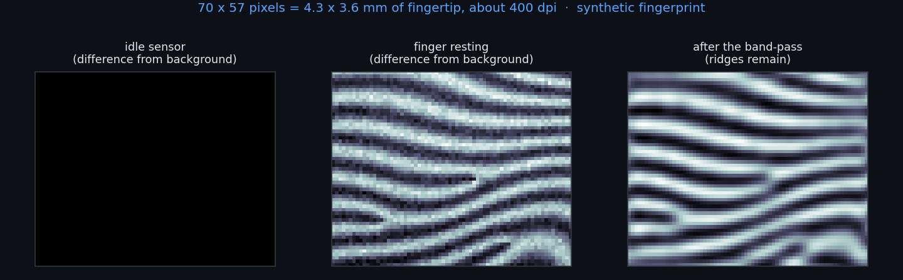
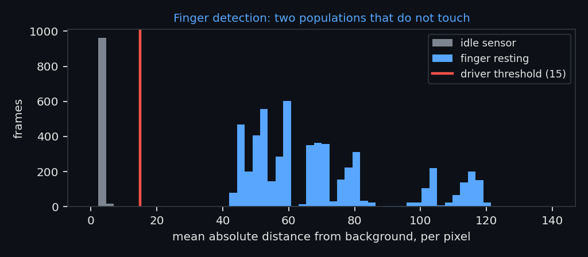
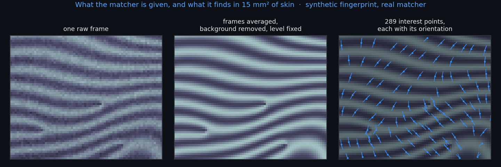
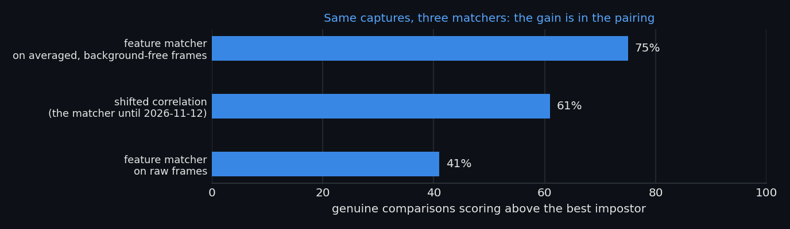
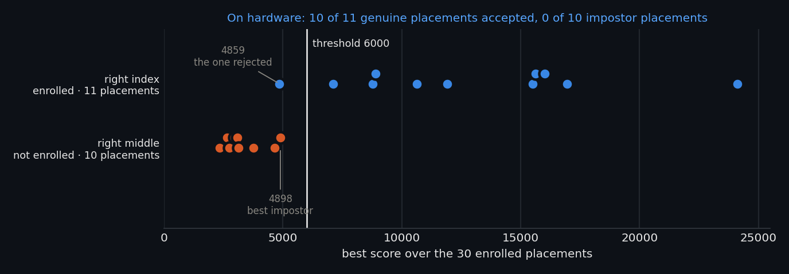
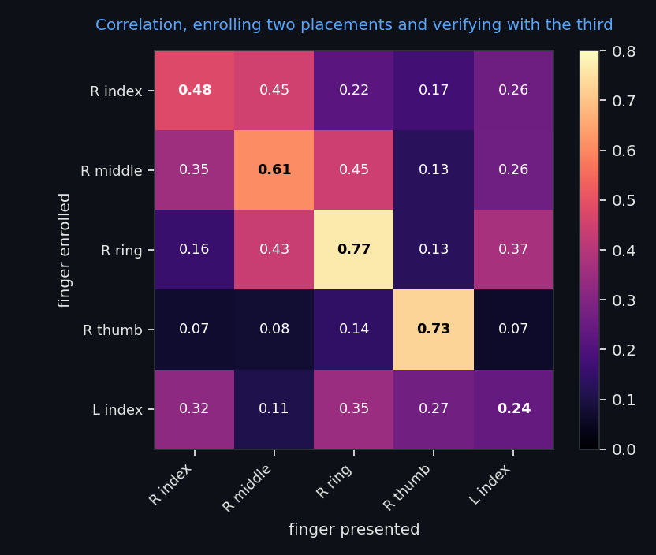
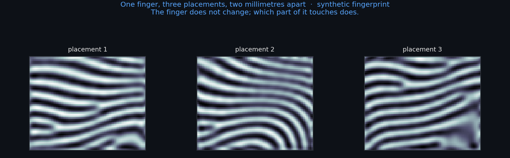

<div align="center">


**A working libfprint driver for the EgisTec EH57E fingerprint sensor
(`1c7a:057e`) — the one inside the power button of Samsung Galaxy Book laptops.**

[](#status)
[](#requirements)
[](https://gitlab.freedesktop.org/libfprint/libfprint)
[](LICENSE)
[](../../actions)
[](#starting-point)

</div>

---

> ## ⚠️ Work in progress — do not rely on this for security
>
> The driver talks to the sensor, enrols, verifies, and authenticates through
> PAM. Since 2026-11-12 the matcher **does** tell the two fingers it was shown
> apart — which the one before it did not.
>
> Measured on hardware, right index enrolled with 30 placements, best score over
> the whole gallery, threshold **6000**:
>
> ```
> right index  (enrolled)      4859 |  7118  8782  8907 10640 11904 15505 15636 16016 16953 24104
> right middle (NOT enrolled)  2340  2639  2658  2763  2960  3083  3145  3761  4669  4898 |
> ```
>
> Ten of eleven genuine placements accepted, none of ten impostor placements.
> With the previous matcher the same two fingers **overlapped**: an unenrolled
> middle finger scored higher than five of eight genuine placements and unlocked
> a `polkit` prompt.
>
> What this is not: an error rate. It is twenty-one observations of one person,
> and the impostor is a different finger of the same hand. **No other person's
> finger has ever been presented to this sensor.** There is no liveness
> detection, the image crosses USB in the clear, and the window is 15 mm² of
> skin.
>
> Use it as a convenience in front of a password you still know. Do not use it
> as a security boundary, and do not ship it to anyone who would.

---

## Contents

- [If your sensor is a different one](#if-your-sensor-is-a-different-one)
- [Status](#status)
- [Starting point](#starting-point) · [Protocol](#protocol)
- [Why it does not use minutiae](#why-it-does-not-use-minutiae)
- [How matching works](#how-matching-works) · [Measurements](#measurements)
- [Methods that were tried and lost](#methods-that-were-tried-and-lost)
- [Requirements](#requirements) · [Building](#building) · [Usage](#usage)
- [Known limitations](#known-limitations) · [Security](SECURITY.md)
- [Roadmap](#roadmap) · [Contributing](CONTRIBUTING.md)
- [Repository layout](#repository-layout) · [Method notes](#method-notes)

---

## If your sensor is a different one

**Read [`CHANGELOG.md`](CHANGELOG.md).** It is the full working log, kept
deliberately: not a list of releases, but a record of how an undocumented sensor
was taken apart — including every wrong turn, and why each direction was chosen
over the alternatives.

That log is likely to be more useful to you than the driver itself, because the
driver only fits `1c7a:057e`. The method transfers:

- how to tell a firmware that **executes** commands from one that merely **echoes**
  them back — the single mistake that can make an entire init sequence look like
  it worked;
- how to find the frame geometry in a stream when the datasheet does not exist:
  autocorrelation peaks give the row stride, and constant-variance regions give
  the padding;
- how to find the analog gain register that decides whether a finger is visible
  at all;
- how to establish that a sensor is **not** a swipe sensor before spending days
  building a stitcher for it;
- how to check whether minutiae matching can work on your contact area before
  committing to it — and what to do when it cannot;
- which published methods were measured here and **lost** (see
  [Methods that were tried and lost](#methods-that-were-tried-and-lost)), so you
  do not spend the same days on them.

Every claim in that log is attached to a measurement, and the measurement scripts
are in this repository. Where something was believed and later disproved, both
the belief and the disproof are still there.

The log is written in Italian; the code, the README and the commit messages are
in English.

---

## Status

| | |
|---|---|
| USB protocol | ✅ reconstructed |
| Image responds to finger | ✅ |
| Finger presence detection | ✅ |
| libfprint driver (`FpDevice`) | ✅ builds and runs |
| `fprintd-enroll` | ✅ `enroll-completed` |
| `fprintd-verify` | ✅ `verify-match` |
| PAM (GDM, lock screen, `sudo`) | ✅ via `authselect` |
| Telling fingers apart | ✅ on the two fingers measured (10/11 accepted, 0/10 impostors) — ⚠️ see [Known limitations](#known-limitations) |
| Permanent installation | ✅ systemd drop-in, survives reboot |

## Starting point

The sensor sits **inside the power button**. On
[linux-hardware.org](https://linux-hardware.org) it showed **0 successes across
118 machines**: no upstream driver, no public protocol documentation.

The device belongs to the **ET5XX** family (Egis internal project `ETU813`), not
the one covered by the existing libfprint drivers:

| | `egis0570` / `egismoc` | **ET5XX (this device)** |
|---|---|---|
| CmdID | `0x00` read, `0x01` write | `0x60`–`0x64` |
| Behaviour | firmware **echoes** the bytes back | commands actually execute |

One byte of difference, and it matters: with `0x01` the firmware only validates
the `EGIS` prefix and echoes the parameters back. An init sequence can report
"24/24 OK" without the device having executed anything at all. `probe6-echo-test.py`
is the test that exposes this.

## Protocol

```
Request:   "EGIS" (45 47 49 53) + CmdID (1B) + Param1 (1B) + Param2 (1B)
Response:  "SIGE" (53 49 47 45) + register (1B) + value (1B) + status (1B)
```

| Cmd | Meaning |
|---|---|
| `0x60` | read / execute register |
| `0x61` | write register |
| `0x62` | burst read |
| `0x63` | burst write |
| `0x64` | image request |

Bulk endpoints `OUT 0x01` / `IN 0x82`.

Each frame arrives as a **5320-byte** block, of which the first **3990 bytes are
the pixels** (70 × 57, 8 bit); the rest is a constant tail. To get a fresh frame
without resetting USB you need the re-arm command
`45 47 49 53 63 2c 02 00 13`.

### The register that made the finger invisible

The factory init leaves the analog front-end gain (register `0x12`) at `0x00`,
i.e. 18 levels of swing: the image is there but the finger is not visible.
Raising it to `0x0a`, with offset (`0x0f`) at `0x20`, makes the finger appear.

<div align="center">



</div>

## Why it does not use minutiae

libfprint matches fingerprints with **bozorth3** (NBIS), which looks for minutiae
— ridge endings and bifurcations. That does not work on this sensor, for a
geometric reason: the window is **4.3 × 3.6 mm, about 15 mm²**, and it contains
almost nothing but parallel ridges. Few minutiae, and rarely the same ones twice.

Measured with `cmp.c`, which calls libfprint's own `bozorth_probe_init` and
`bozorth_to_gallery` directly: **8 points** when comparing two images of the same
finger, against an acceptance threshold of **40**.

So the driver does not hand an image to libfprint. It implements its own matcher.

## How matching works

1. **Background.** On open, average 8 frames of an untouched sensor, discarding
   any frame contrasty enough to already contain a finger.
2. **Finger presence.** Mean absolute per-pixel distance from that background,
   *after removing any uniform level shift* (see
   [The stale background](#the-stale-background)). Idle sits between 2.4 and 4,
   a finger between 49 and 130. The threshold is **15**, comfortably in between.

   <div align="center">

   

   </div>

3. **Template.** Average of 40 frames (the finger is stationary, so averaging
   only cancels noise) with the background subtracted, brought to a fixed mean
   and deviation (128 / 40) and stored as an 8-bit image, 3990 bytes per
   placement. The fixed level is not cosmetic: the same finger arrives with a
   frame mean anywhere between 48 and 156 depending on pressure.
4. **Matching.** Interest points on each image, a binary descriptor of the
   surroundings of each, nearest-neighbour pairing between probe and enrolled
   placement, and then the step that matters: only pairs that agree on **one
   common shift and rotation** are kept, and the score is summed over those.
   The best score over all enrolled placements is compared with **6000**.

   <div align="center">

   

   </div>

### The matcher that replaced the correlation

Until 2026-11-12 step 4 was a normalised cross-correlation of band-passed
templates, maximised over shifts of ±8 pixels. It was built carefully, tuned
against real captures, and it could not do the job: ridges are near-parallel
lines, and a correlation is happy to slide one person's lines onto another's.
The unenrolled middle finger reached 0.734 against a threshold of 0.55.

Before writing a third matcher from scratch, the question was whether anyone
else had already solved this. In August the answer had been no — 0 successes on
118 machines. By November there were three independent drivers for this exact
sensor and two for its twin, the EH576 (same 70 × 57 geometry). One of them,
[lagthedark/eh57e-libfprint](https://github.com/lagthedark/eh57e-libfprint),
ships a matcher described as a reimplementation of the vendor's Windows engine.

It was measured before it was adopted, offline, on the labelled captures already
in hand (index and middle, three placements each, pairs from the same placement
excluded):

| | genuine median | best impostor | genuine above best impostor |
|---|---|---|---|
| correlation (the old matcher) | 0.436 | 0.377 | 61% |
| feature matcher on **raw** frames | 4010 | 4260 | 41% |
| feature matcher on averaged, background-subtracted, level-fixed frames | **7174** | **3712** | **75%** |

<div align="center">



</div>

Two things came out of that table. The feature matcher is better — and fed raw
frames, the way its own driver feeds it, it is *worse* than what it replaces.
The gain is in the pairing: their matcher, this driver's acquisition. So only
`egis057e-matcher.[ch]` was taken, unmodified, and the rest of that driver was
left where it was.

Then on hardware, with a full 30-placement gallery — the numbers at the top of
this page. The gallery did what the old README predicted a gallery does: the
best impostor rose from 3712 against one placement to 4898 against thirty. The
first threshold, 5000, had been set from the offline table and was left two
percent above it. Nothing lies between 4898 and 7118 except one genuine
placement at 4859 that no threshold above the impostors can save, so the
threshold moved to 6000.

<div align="center">



</div>

A verification against thirty placements costs about 0.9 s: 26 ms to extract
the features of one image, 4 ms to compare two sets.

**A mistake made along the way, kept because it is instructive.** The first
offline comparison reported impostor pairs correlating at exactly 1.0. Two
different fingers do not do that. The older capture files begin with 24 to 206
frames of an *empty* sensor, and the frames sampled for the test had landed
there: an empty sensor resembles an empty sensor perfectly. A result that is
too clean in either direction is a property of the data until proven otherwise.

### The sensor that stopped answering

During that same hardware session a verification was interrupted with Ctrl-C
while an image was on the wire. From then on every open failed with
`transfer timed out`, and restarting the daemon changed nothing.

The sensor was still enumerated and the kernel logged no reset. It simply had
**6344 bytes still to say** — the 1024 that remained of the interrupted block,
then a whole one — and the init sequence reads 64 bytes at a time. Reading the
endpoint from user space with a 16 KB buffer emptied it, and the very next
command was answered normally.

The driver now does the same before its first command: at most four large
reads, each giving up after 200 ms. No USB reset is involved, which matters
here more than usual — reset storms on this device are what froze the entire
machine three times in August (see [`CHANGELOG.md`](CHANGELOG.md)).

### Exposure: the mistake that cost the most

The analog gain was originally set to `0x0a`, because at `0x00` the finger was
not visible. That test was run *before* the offset was fixed — the wrong knob was
turned, and once the offset was set to `0x20` the high gain was no longer needed.
Nobody went back to re-measure.

Sweeping the gain with a finger held still, at offset `0x20`:

| gain | saturated pixels | ridge-band SNR |
|---|---|---|
| `0x00` | 0.0% | 19.9 dB |
| **`0x01`** | **1.9%** | **20.2 dB** |
| `0x04` | 24.0% | 19.1 dB |
| `0x0a` | **42.5%** | 16.2 dB |
| `0x0f` | 49.8% | 14.5 dB |

**Between a quarter and three quarters of every image was arriving clipped** to 0
or 255. That is information destroyed at acquisition, which no matcher can
recover, and destroyed exactly where the signal is strong — so what survived was
dominated by *where the finger presses*, which is the component every finger has
in common.

The consequence was a real false accept: an unenrolled middle finger scored 0.526
and 0.633 against an enrolled index, above the threshold of the time. After the
correction, on the same pair: index 0.728, middle 0.303.

The general lesson, and it is the most expensive one in this repository: **an
acquisition parameter is chosen by measuring what it destroys, not by stopping at
the first value where the image becomes visible.** Four different matching
algorithms were tried and rejected before anyone measured the images themselves.

### Measurements (the correlation matcher)

*Everything from here to [The stale background](#the-stale-background)
describes the correlation matcher that was replaced. It stays because the
reasoning that led away from it is the useful part.*

Five fingers, three placements each. Placements 1 and 2 are enrolled, placement 3
verifies — it never enters enrolment, otherwise the experiment would only measure
how well something resembles itself.

<div align="center">



</div>

Genuine 0.241 – 0.767, impostors up to 0.451.

> ⚠️ **These offline figures were measured on saturated captures** (gain `0x0a`),
> before the exposure problem above was found. They are kept because they
> document the reasoning, but every conclusion drawn from that dataset — including
> the rejections of BLPOC, mosaicking, peak sharpness and T-norm — was reached on
> damaged signal and is due to be re-measured.
>
> Twenty cross-finger comparisons are also **not** a false-acceptance rate. That
> would take thousands.

On hardware, after the exposure fix, across two separate 30-placement enrolments:

    genuine    0.585  0.672  0.704  0.757  0.817  0.854  0.947
    impostor   0.497  0.508  0.520

The gap between 0.520 and 0.585 is where the threshold sits. Ten observations do
not measure an error rate, the margin is 65 thousandths, and the only impostor
ever presented was the same person's middle finger — never another person's.

### Why it needs many placements

On the same finger, different placements score very differently:

<div align="center">



</div>

With a 15 mm² window, moving two millimetres means photographing a different part
of the fingertip. The only lever measured to raise genuine scores is the number
of **distinct placements** enrolled (1 placement → 0.143, 2 → 0.288), while
quadrupling the frames taken from a single placement changes nothing. Hence
**30 enrolment stages**.

Widening the search instead makes things worse, because ridges are near-parallel
lines and more freedom lets them align with anybody:

| max shift | worst genuine | best impostor |
|---|---|---|
| **8** (chosen) | 0.241 | **0.451** |
| 12 | 0.317 | 0.600 |
| 16 | 0.439 | 0.611 |

### The stale background

Presence detection compares each frame against a background learned once, at
open. That broke twice in the first real session: the idle level stepped from
3.9 to 22–29 and never came back down, so the "wait for the finger to lift" phase
never completed and the driver went deaf. It stalled one enrolment at 6 stages
out of 20, and a run of verifications at the third.

It was a step, not a slow drift, and one that moved the whole image by the same
amount — a DC level change in the analog front end, not a change in texture.
Comparing pixels after subtracting the difference between the frame mean and the
background mean removes it by construction.

The cost is small: on the recorded captures, with a finger the minimum stays at
27.0 and without a finger the maximum is 25.8 (median 3.9). At a threshold of 15,
none of the 5616 finger frames falls below, and only one of 984 idle frames rises
above.

### Methods that were tried and lost

Negative results are kept here because they cost real work and would otherwise be
repeated.

| Method | Result |
|---|---|
| **Minutiae (bozorth3)** | 8 points, same finger, threshold 40. Too little area. |
| **Swipe stitching** | The finger does not translate over the sensor; only pressure changes. See [Method notes](#method-notes). |
| **Wider shift search** | Raises genuine scores, raises impostors more. |
| **BLPOC** | 3 errors out of 25 vs. 1 for plain correlation. |
| **Shifted correlation** (the matcher until 2026-11-12) | Works on a gallery of two, fails on a gallery of thirty: an impostor at 0.734 against a threshold of 0.55. Parallel ridges align with anybody's. |
| **The feature matcher on raw frames** | 41% of genuine pairs above the best impostor, against 61% for the correlation. Exposure varies more between two touches than ridges do between two fingers. |

**BLPOC** (band-limited phase-only correlation) deserves a note, because it is the
textbook method for small-area sensors. It divides the cross-spectrum by its own
magnitude, keeping only phase, which should make it insensitive to contrast and
pressure. Five variants were measured (low-pass block and ridge-frequency annulus,
with and without a Hann window); all of them scored 3 errors out of 25, against 1
for the normalised cross-correlation already in use. The likely reason is that
throwing away the magnitude also throws away ridge contrast, which on 15 mm² is
real information rather than a nuisance.

## Requirements

- Linux with `libfprint` 1.94.x and `fprintd`
- `meson`, `ninja`, a C toolchain, glib/gusb development headers
- Python 3 with `numpy` (analysis tools only) and `matplotlib` (only to
  regenerate the figures)

## Building

The driver lives inside a libfprint checkout:

```sh
git clone https://gitlab.freedesktop.org/libfprint/libfprint.git libfprint-src
cp driver/egis057e.[ch] driver/egis057e-matcher.[ch] libfprint-src/libfprint/drivers/
```

Register it in two places:

```meson
# meson.build
'egis057e': {},

# libfprint/meson.build
'egis057e' : files('drivers/egis057e.c', 'drivers/egis057e-matcher.c'),
```

Then build:

```sh
meson setup libfprint-src/build libfprint-src
ninja -C libfprint-src/build
./libfprint-src/build/libfprint/fprint-list-supported-devices | grep 057e
```

## Usage

`fprintd` has to run against the locally built library rather than the system
one. The two cannot coexist: `net.reactivated.Fprint` is a single name on the
system bus.

```sh
sudo systemctl stop fprintd.service
sudo env LD_LIBRARY_PATH=$PWD/libfprint-src/build/libfprint \
     /usr/libexec/fprintd -t
```

`-t` disables the idle exit; without it `fprintd` takes the bus name and dies
after thirty seconds of silence, handing the name back to the system service.

From another terminal:

```sh
fprintd-delete $USER                    # prints from before 2026-11-12 are refused
fprintd-enroll -f right-index-finger    # 30 placements
fprintd-verify -f right-index-finger
```

**Rest your finger, do not press:** the sensor *is* the power button, and pressing
suspends the laptop. Lift between placements and move the finger a little each
time — it is the *distinct* placements that count.

### Installing permanently

`scripts/install.sh` puts the built library in `/usr/local/lib/egis057e` and
adds a systemd drop-in so `fprintd` finds it, without overwriting the
distribution's own copy:

```sh
sudo scripts/install.sh
```

`/usr/local/lib` rather than a home directory because SELinux in `Enforcing`
denies a confined service loading a library from `/home`; there, `restorecon`
applies the right label and no denials are logged.

To undo it:

```sh
sudo rm -rf /usr/local/lib/egis057e
sudo rm /etc/systemd/system/fprintd.service.d/egis057e.conf
sudo systemctl daemon-reload && sudo systemctl restart fprintd
```

For PAM, enable the feature the distribution already ships:

```sh
sudo authselect enable-feature with-fingerprint
```

### Reading the scores

While the threshold is still being tuned, it is worth having the driver log what
it actually measured. Add to the drop-in:

```
Environment=G_MESSAGES_DEBUG=libfprint-egis057e
```

then

```sh
journalctl -u fprintd -f | grep "best score"
```

A rejection and a near-miss look identical from the outside, and the difference
decides whether the fix is a better enrolment or a different threshold.

**One thing worth knowing as a user:** the driver averages about half a second
of continuous contact before it decides. A quick tap gives it a poor sample and
is the most likely cause of a rejection that feels arbitrary. Rest the finger,
count to two, lift.

## Known limitations

- **The threshold rests on twenty-one observations** of one person. It is the
  honest reading of what was seen, not a guarantee.
- **No other person's finger has ever been presented to this sensor.** Every
  impostor measurement is a different finger of the same hand.
- **No serious FAR measurement.** That takes thousands of comparisons across
  many people.
- **About one genuine placement in ten is rejected**, when it lands on skin the
  enrolment did not cover. Lift and place again.
- **Prints enrolled before 2026-11-12 are refused** with an explicit error: the
  stored format changed with the matcher. Delete and enrol again.
- **The matcher's provenance.** `egis057e-matcher.[ch]` comes from
  [lagthedark/eh57e-libfprint](https://github.com/lagthedark/eh57e-libfprint)
  (0BSD) and is, by its author's description, a reimplementation of a
  proprietary engine. That rules this driver out of upstream libfprint as it
  stands; a matcher built on an open method would be the way there.
- **The matcher reads `EGIS057E_M_*` environment variables** for its internal
  tunables. Inside `fprintd` only root sets those, but it is a knob that exists.
- **Interrupting a verification mid-image has not been re-tested** since the
  drain fix; eleven consecutive ordinary opens after it were clean.
- **No `identify`.** The driver advertises only `FP_DEVICE_FEATURE_VERIFY`.
- **No udev rule** is emitted for `1c7a:057e`; `fprintd` runs as root, so it has
  not been needed so far.
- **No anti-spoofing.** The matcher only looks at ridge texture.

## Roadmap

Ordered by expected payoff per unit of effort:

1. **Template update on successful verification.** Every placement accepted
   with a comfortable score joins the stored print, so coverage of the fingertip
   grows with use. It is what the vendor engine does, libfprint already has
   `FP_DEVICE_FEATURE_UPDATE_PRINT` for it, and it is aimed squarely at the one
   kind of error measured so far: a genuine finger landing off the enrolled
   area.
2. **A two-witness rule.** Accept only when two *different* enrolled placements
   agree, or two consecutive frames do. An impostor's best score is one lucky
   placement out of thirty; asking for a second independent one costs a genuine
   finger little. The log already prints the second-best score for exactly this
   measurement.
3. **Score normalisation.** Judge a score against how that same touch scores
   against other people's prints, instead of against one fixed number.
4. **Other people's fingers.** Not an algorithm, but the measurement everything
   above is waiting for.
5. **An open matcher.** SIFT-style matching (SIGFM) is the community's answer
   for small sensors and would remove the provenance question.
6. **Learned descriptors.** What phones do, and the genuine state of the art.
   Needs training data that one person's fingers cannot supply.

## Repository layout

| Path | Contents |
|---|---|
| `driver/` | the driver, to be copied into a libfprint checkout |
| `docs/` | README figures and the script that generates them from real data |
| `capture2.py` | base library: init, commands, frame reads |
| `capture-set.py` | records the test set (5 fingers × 3 placements) |
| `analisi.py` | measurement protocol: enrol 1+2, verify with 3 |
| `atterraggio.py` | is the start of a placement worse than the rest? (no) |
| `blpoc.py` | band-limited phase-only correlation, measured and rejected |
| `matchtest.c` | checks the driver's C matcher against the Python prototype |
| `cmp.c` | comparison against bozorth3 — the evidence that minutiae fail here |
| `probe*.py` | the protocol reconstruction, step by step |
| `CHANGELOG.md` | the full log, including method errors |

`probe*.py`, `stitch.py`, `mintest.c` and similar document measurements that have
since been superseded. They stay because the path matters as much as the result,
and because some of them describe **wrong** turns worth not taking again.

## Method notes

`CHANGELOG.md` records method errors as well as progress. Two are worth repeating
here, because both produced results that were false and convincing.

1. **The mosaic that never existed.** An attempt to reconstruct a large
   fingerprint by stitching consecutive frames produced a 115 × 189 pixel image
   with 44 minutiae. It was an artefact: phase correlation returns integer
   shifts, the real displacement between consecutive frames was 0.3 pixels, and a
   thousand ±1 pixel errors accumulate as a random walk. Measured against a held
   reference frame instead, the real displacement is **zero**: the finger does not
   translate over the sensor, only pressure changes. It is not a swipe sensor.
2. **The innocent landing.** The hypothesis that the driver was sampling the
   finger while it was still landing was reasonable and wrong: measured with
   `atterraggio.py`, the difference between the start, middle and end of a
   placement is **0.015**. Noise.

## Contributing

Bug reports, device reports and measurements are welcome. See
[CONTRIBUTING.md](CONTRIBUTING.md) — the one rule that matters is that every
claim comes with a measurement, and that negative results are kept rather than
discarded.

If you have an Egis sensor that is not `1c7a:057e`, the **Device report** issue
template is the place to start, even if nothing works yet.

## Security

Read [SECURITY.md](SECURITY.md) before relying on this for anything.

In short: the false-acceptance rate of this matcher **is not known** — it has
been measured against ten impostor placements of one person's other finger,
which cannot establish a rate. There is no liveness detection of any kind. The sensor images about 15 mm²
of skin, which is a hard limit on how much can be distinguished. Treat it as a
convenience in front of a password you still know, not as a security boundary.

## License

**LGPL-2.1-or-later**, the same as libfprint. Full text in [LICENSE](LICENSE).
`driver/egis057e-matcher.[ch]` are third-party and carry their own 0BSD
notice.

The proprietary Egis/Microsoft binaries used as a reference during reverse
engineering are **not in this repository** and are not redistributable.

## Acknowledgements

- The [libfprint](https://gitlab.freedesktop.org/libfprint/libfprint) project and
  its existing Egis drivers, which provided exactly the right wrong starting
  point.
- [lagthedark](https://github.com/lagthedark/eh57e-libfprint), whose matcher
  this driver now uses, and the authors of the EH576 drivers
  ([PHILIPPDEV5396](https://github.com/PHILIPPDEV5396/libfprint-egis0576),
  [tsteppy](https://github.com/tsteppy/egistec-eh576-libfprint)), whose
  unusually honest accuracy write-ups set the standard for this one.
- NIST, for NBIS and for making it verifiable — even when the answer is "this
  method does not work here".
